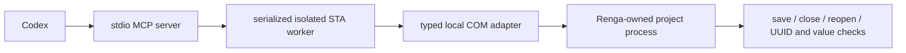

# Renga–Codex Bridge

Independent, unofficial local MCP integration for Codex and Renga BIM. Codex
interprets the task; this package provides typed COM operations, geometry,
native documentation and saved-result verification. No AI API key, second
agent service or design chat application is required.

**0.1.0 preview — verified subset for Renga Professional 9.3.32980.0.**
Real local CLI and MCP scenarios create and edit native BIM objects, then save,
close, reopen and check the requested values. See the scoped
[native evidence](tests/evidence/windows-renga-9.3.json) and
[testing instructions](docs/TESTING.md); hosted CI does not run Renga.
Computer Use and mouse/keyboard emulation are prohibited for advertised API
coverage. Renga and its SDK must be installed/licensed separately. No vendor
binaries, SDK-generated wrappers, private models or credentials are shipped.

## Installation

Windows x64, Python3.11+, installed Renga and separately downloaded SDK:

```powershell
.\scripts\install.ps1 -PythonExe 'C:\path\to\python.exe' -SdkPath 'C:\path\to\RengaSDK'
```

Read [Russian installation](docs/INSTALL_RU.md) or
[English installation](docs/INSTALL_EN.md), [capabilities](docs/CAPABILITIES.md),
[previous work analysis](docs/PREVIOUS_WORK_ANALYSIS.md) and
[repository research](docs/REPOSITORY_RESEARCH.md).

## Architecture



Core modules: session/safety/audit, SDK loading, BIM operations, geometry,
catalogs, native drawings/exports, verification, deterministic plan helpers.
API coordinates are millimeters; area m² and volume m³ are labelled explicitly.

The 20 MCP tools cover status and capabilities; inspection and catalogs;
validated plans and disposable-copy previews; geometry and area verification;
project copy, SaveAs and metadata; native drawing content, PDF, IFC and view
rendering; rectangle plans and facade spacing. The complete names and verified
boundaries are in [CAPABILITIES.md](docs/CAPABILITIES.md).

```powershell
.\.venv\Scripts\renga-bridge.exe doctor
.\.venv\Scripts\renga-bridge.exe inspect --project 'C:\your\test-root\sample.rnp'
.\.venv\Scripts\renga-bridge.exe apply --project 'C:\your\test-root\sample.rnp' --plan examples\rectangle.json --new
python -m pytest -m 'not integration' -q
```

Autonomous writes are confined to `RENGA_BRIDGE_WRITE_ROOT`. Existing-file
edits receive verified backups and native undo transactions. Dependent hosts
and some calculated geometry need several applied batches before the final
save; failed plans discard unsaved changes, rather than promising a single
in-memory undo for every category. There is no MCP
blanket authorization bypass. Copy saved user files into the dedicated working
directory before editing; never run vendor sample scripts against user files.

Codex translates a task into an explicit millimeter-based JSON plan, inspects
existing IDs/styles, validates the plan, optionally previews it on a copy,
applies it and reads the reopened result. See
[operation plans](docs/OPERATION_PLANS.md). Reconnect the MCP server or start a
new Codex session after installation. Both a fresh Codex protocol backend and
the existing Codex chat discovered all 20 tools. The current chat also copied a
test model, edited a wall from 3400 to 3600 mm and independently read the saved
height and unchanged persistent identity through the actual MCP tools.

## Русский

Это инфраструктура доступа Codex к настоящей Renga через MCP и типизированный
COM API. Все операции выполняются локально, без Computer Use. Публикуемое
покрытие ограничено фактически проверенными возможностями. Автоматические
размеры/маркеры и создание автоматических помещений нельзя имитировать
текстом или изображениями. Ненулевые уровни используйте из существующего
проекта; неподтверждённые изменения отметок отклоняются.

MIT applies to our own source. See [NOTICE](NOTICE.md) for third-party and
Renga SDK boundaries. This project does not represent Renga Software.
