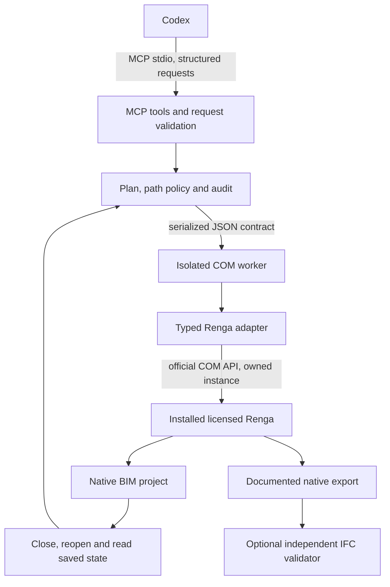

# Architecture recommendation for Bridge 0.1

Decision date: 2026-10-14. Scope: local Windows integration infrastructure. Codex remains the only language/planning agent. There is no additional AI service, API key requirement, design chat application or web backend. Computer Use and hidden mouse/keyboard/UI Automation substitutes are excluded from this product.

## Decision: typed Python COM backend, replaceable adapter

Use a Python MCP stdio server with a validated operation contract, a separate serialized COM worker process, typed `comtypes` interfaces generated locally from the user's installed Renga type library, and independent verification. Keep the worker/adapter boundary replaceable by C# without changing MCP tool semantics.

The user's preliminary C# preference was evaluated, not ignored. `rnpmcp` demonstrates a workable .NET 8 MCP/STA architecture; RengaInspector demonstrates typed .NET 8 interop. However, rnpmcp's dynamic adapter attaches to running sessions, has no open/save/close lifecycle, and does not supply exact geometric records. Its own limitations include late-bound GUID/placement marshaling problems. A production C# backend would need new owned-session handling, locally generated typed interop, geometry, persisted verification and native testing. The available development environment has an established typed Python COM lifecycle and native smoke evidence, while the required .NET SDK/build pipeline and equivalent typed C# backend are not established. This is a risk/evidence choice for 0.1, not a claim that C# cannot control Renga. [rnpmcp source](https://github.com/proovcme/rnpmcp/blob/8051cc7037ffa4314fddd9b04f35c9c8069e182e/src/RengaMcp.Server/Adapters/DynamicComRengaAdapter.cs), [STA architecture](https://github.com/proovcme/rnpmcp/blob/8051cc7037ffa4314fddd9b04f35c9c8069e182e/src/RengaMcp.Server/Infrastructure/StaWorker.cs), [typed C# project](https://github.com/karpovichpv/RengaInspector/blob/a350d7723ad69af8eb07690d25efddeed5209bbb/Inspector/Inspector.csproj).

Previous native testing informed this choice; it does not substitute for fresh tests of the public Bridge. The repository research and capability/test reports must distinguish previously observed behaviour, documented support, and what this release actually verifies.

## Component boundaries

| Boundary | Responsibility | Must not do |
|---|---|---|
| MCP tools | Discovery, typed requests, pagination, structured error/result envelopes | Perform COM calls in arbitrary async transport threads |
| Plan/policy | Validate units, object references, allowed operations and paths; record requested changes | Execute generated code or silently authorise arbitrary file edits |
| COM worker | Initialise COM apartment, own/release resources, serialize execution and enforce timeouts | Attach to the user's running Renga or export COM pointers across processes |
| Renga adapter | Project lifecycle, typed interfaces, transactions, parameters, baselines and export | Claim a setter worked before rereading saved output |
| Geometry/operations | Exact coordinates, placements, curves, styles/hosts and supported BIM types | Use lines or external meshes as undocumented substitutes for native BIM objects |
| Documentation tools | Only publicly supported drawing/view/text/schedule/export operations | Create fake native dimensions/markers or invoke hidden GUI commands |
| Verification | Independent quantities/geometry and persistent identity checks | Treat mock success or IFC validity as proof of native Renga editability |
| Installer | Discover Renga, configure local paths/MCP, create backups, diagnose and uninstall own components | Bundle proprietary SDK/components or overwrite unrelated client settings |

These are responsibility boundaries, not a requirement for many services. The server and one worker entry point are enough. Geometric computations can run outside COM on plain arrays. An optional IFC verifier is an independently installed library/process, not a mandatory Renga replacement.

## Session and transaction rules

1. Canonicalise project/output paths, reject forbidden writes and acquire an exclusive file lock before creating a session. New-project commands refuse to overwrite existing output. Existing-file mutations require a verified backup and explicit path-level authorisation where applicable.
2. Start a separate Renga instance through the official API; verify process ownership. If the activation resolves to an existing user process, fail instead of attaching. Only the owned application may be closed or terminated during cleanup.
3. Inspect the current saved model before selecting IDs or changing parameters. Address long-lived objects by `UniqueId`; use fresh numeric IDs only for the current COM session.
4. Execute a validated plan inside an undo-capable transaction. Preview executes the same native operation and rolls back. Failure rolls back and records the provisional/failed result rather than returning success.
5. After Apply, reread the model. Save in native format, close, reopen the saved file, resolve IDs again and verify requested parameters, persistent identities and relevant geometry. Return separate `applied`, `saved`, `reopened` and `verified` outcomes.
6. Release COM references on their owning apartment/process. Cancellation or timeout must not be described as rollback unless rollback was actually observed; preserve backups and report uncertain state.

Export has its own result checks: return code, file existence/nonzero size and structural/visual or semantic checks appropriate to the format. Official drawing export examples establish API signatures, not a complete safety lifecycle. [Sample exporter](https://github.com/RengaSoftware/SampleScripts/blob/c626cbfbdc72eac0be9019106235193143fd6832/ExportDrawings/export_topic_drawings.py).

## Typed geometry and capability discovery

All plan coordinates are explicit millimetres. Angles, areas and volumes retain stated units. Read parameter definitions, value types, read-only status and quantity presence instead of guessing from localised labels. Preserve GUID identity, distinguish null/unset quantities from zero, and handle actual interface availability per installed version.

Runtime-generated wrappers and SDK-derived lookup caches are local, untracked artifacts. Public code may locate the user's installation/type library and implement our own adapter logic; it must not copy vendor SDK trees, generated interop assemblies, screenshots or complete vendor documentation into a package. [Official API](https://help.rengabim.com/api/), [Renga EULA](https://rengabim.com/files/eula_ru-ru.pdf).

A documented creation method is not proof that every type/placement/parameter is writable. Examples requiring explicit validation include nonzero level elevation, native axes/dimensions/markers, automatic room creation and title-block cells. Under the no-Computer-Use policy, an operation previously achieved only through UI remains unsupported by this Bridge until a supported programmatic implementation is found and tested. Reading or updating a pre-existing object is classified separately from creating it.

Native geometry after joins can differ from a baseline or unjoined bounding box. Verification should compare intended hosts, connected faces, contours, actual occupied geometry and quantities. Door/window host side and filling orientation need typed creation/parameter checks; an accepted generic placement call alone is insufficient. Rooms need independent area tests; automatic region calculation includes surrounding objects and other rooms, so overlap and open functional zones must be handled explicitly.

Every exposed operation has one of:

- `IMPLEMENTED_AND_TESTED`: our native test verifies saved/reopened output.
- `SUPPORTED_NOT_IMPLEMENTED`: an official interface exists but the tool/backend is absent.
- `API_LIMITATION`: documented or repeatedly demonstrated lack of a supported operation, with evidence and version.
- `NOT_VERIFIED`: presence/invocation is not yet backed by a persisted native check.
- `VERSION_DEPENDENT`: explicit version/edition requirements or observed differences.

The capability report includes version, evidence/test reference and reason. An implementation gap is not relabelled a Renga platform limitation. C# plugins or STDL are investigated only where they provide an official additional interface; their existence does not imply access to undocumented model internals.

## What to reuse and what to develop

Reuse architectural ideas, not an unsafe session attachment: rnpmcp's tool/adapter separation, serial execution, bounded results and real rollback previews; SampleScripts' documented property/export sequences; ModelExplorer's container/interface discovery approach; STDL and IFC mappings as optional configuration references. No upstream source is vendored in 0.1. RengaInspector remains research-only because no reuse license was found. See [repository analysis](REPOSITORY_RESEARCH.md).

Implement our own owned lifecycle, path/backup policy, exact typed geometry, batch plans, UUID remapping, drawing/export tools that are actually supported, persistent verification, install/uninstall configuration management and real MCP end-to-end tests. Keep schemas versioned so a future typed C# backend can be tested against the same cases and replace the Python worker without changing natural-language workflows.

Optional IfcOpenShell checks parse a native export, validate schema and compare selected entities/quantities. Check IFC unit conversion explicitly rather than assuming the geometry engine always emits metres; a current upstream report describes a silent millimetre-scale case. Select the intended Body representation. Never use successful IFC validation to claim all native Renga geometry, drawings or editability survived. [IfcOpenShell unit issue](https://github.com/IfcOpenShell/IfcOpenShell/issues/9926).

## Evidence required before a release claim

Use synthetic, non-personal projects and API calls only. A native end-to-end test must exercise MCP discovery/request handling, owned activation, creation, exact positioning, modification, quantities/geometry, supported documentation and export, save/close/reopen and final comparison. Preserve failures and provisional calls. Include tests for rejected overwrites, forbidden paths, backup integrity, concurrent edits, read-only setters, unsupported operations and timeout/error cleanup.

Unit tests verify policy and numerical algorithms; mock tests verify transport/contracts. Neither establishes real BIM integration. A release report records installed Renga/API/Python versions, dependency pins, capability statuses and real test evidence. Computer Use count for these product tests must remain zero. Unsupported documentation operations are explicit limitations, not fake output files or claims of complete automation.

## Русский итог решения

Версия 0.1 использует Python, типизированный `comtypes`, MCP и отдельный процесс COM с проверкой принадлежности Renga. Предпочтение C# рассмотрено: этот стек подходит, но проверенная точная геометрия и жизненный цикл сейчас есть у Python-прототипа, а типизированный .NET-адаптер и его сборка/испытания потребовали бы отдельной разработки. Контракт инструментов допускает такой адаптер позднее. Продукт независимый и неофициальный; Renga устанавливается и лицензируется пользователем. Запрещённые UI-обходы, SDK, пользовательские модели и нелицензированный сторонний код в поставку не входят.
